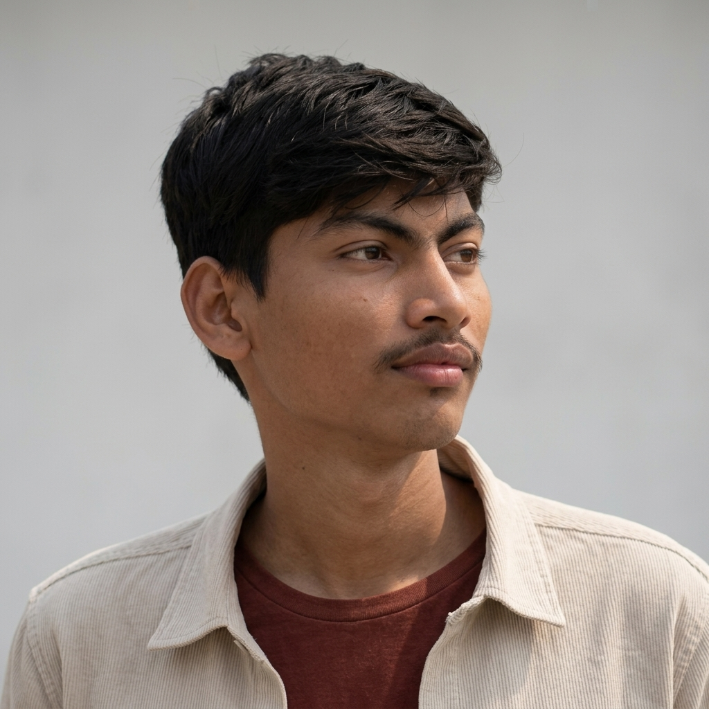

# Bhavesh Ashok Sonawane - Personal Portfolio Website

A clean, minimalist, and responsive developer portfolio website built with modern HTML5, CSS3, and JavaScript.

---

## 🌟 Highlights & Features

- **Clean Minimalist Light Aesthetic**: Crisp typography, high contrast, clean card styling, and subtle animations.
- **Theme Switcher**: Instant toggle between Clean Light mode and Dark mode with persistence via `localStorage`.
- **Dynamic Hero Section**: Interactive typing animation showcasing frontend specialties.
- **GitHub Integration**: Direct links to [bhaveshsonawane921-sudo](https://github.com/bhaveshsonawane921-sudo) and live avatar integration with graceful fallback.
- **Frontend Skills & Competencies**: Visual progress bars and categorized strengths tailored for Frontend Engineering.
- **Showcase Projects**: Clean project cards with category tags, tech stacks, and GitHub/Demo links.
- **Experience & Education Timeline**: Clean journey overview.
- **Interactive Contact Form**: Client-side validation with responsive feedback.
- **Mobile-First & Fully Responsive**: Optimized for desktops, tablets, and smartphones.

---

## 📁 File Structure

```
Bhavesh/
├── index.html        # Main HTML structure with semantic sections
├── style.css         # Modern CSS with custom properties & responsive queries
├── script.js         # Typing effect, theme toggle, scrollspy, and form handler
└── README.md         # Documentation & guide
```

---

## 🚀 How to Preview & Run

1. Open the folder: `c:\Users\RCP\Desktop\Bhavesh`
2. Double-click **`index.html`** to open it in your browser (Google Chrome, Microsoft Edge, Firefox, Brave, Safari, etc.).
3. Or serve it locally using VS Code's **Live Server** extension or Python:
   ```bash
   python -m http.server 8000
   ```

---

## ⚙️ How to Customize

1. **Profile Picture**:
   - The website automatically pulls your avatar from GitHub (`https://avatars.githubusercontent.com/u/237987842?v=4`).
   - If you want to use a local image, place `profile.jpg` into this folder and change the `src` attribute of the `` tag in `index.html`:
     ```html
     
     ```

2. **Add / Modify Projects**:
   - In `index.html`, locate `<section class="section projects-section" id="projects">`.
   - Update repository links, descriptions, and tags.

3. **Social & Contact Details**:
   - Update your email address and LinkedIn URL in `<div class="contact-methods">` and `<div class="social-links">`.
